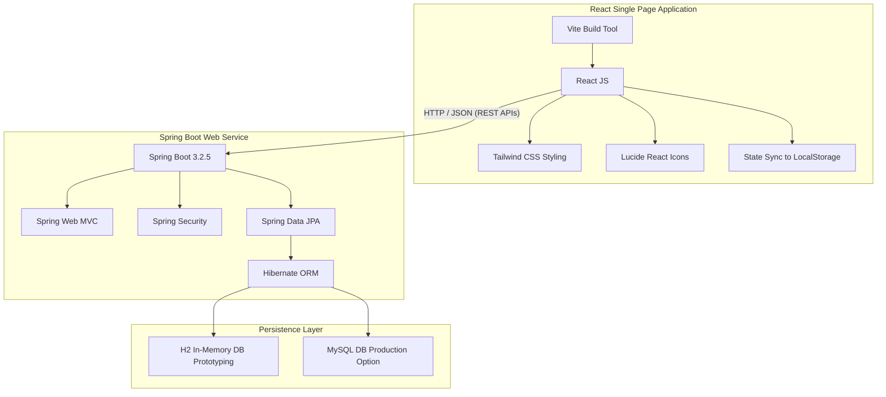

# ✨ SheReDefine ✨

[](https://spring.io/projects/spring-boot)
[](https://react.dev/)
[](https://vitejs.dev/)
[](https://tailwindcss.com/)
[](https://openjdk.org/)
[](https://opensource.org/licenses/MIT)

**SheReDefine** is a modern, comprehensive, women-only career and opportunity platform. It is engineered to help women build their professional profiles, find tailored opportunities, engage in supportive learning communities, and successfully launch, switch, or return to their career journeys.

---

## 📖 Table of Contents

- [🚀 Key Modules & Features](#-key-modules--features)
  - [1. User Cohorts](#1-user-cohorts)
  - [2. Opportunities Hub](#2-opportunities-hub)
  - [3. Interactive Communities (Clubs)](#3-interactive-communities-clubs)
  - [4. Upskilling & Practice Suite](#4-upskilling--practice-suite)
  - [5. Host/Recruiter Suite](#5-hostrecruiter-suite)
  - [6. Admin Panel](#6-admin-panel)
- [🛠️ Tech Stack & Architecture](#️-tech-stack--architecture)
- [📂 Project Directory Structure](#-project-directory-structure)
- [⚡ Local Development & Setup](#-local-development--setup)
  - [Backend Setup (Spring Boot)](#backend-setup-spring-boot)
  - [Frontend Setup (React + Vite)](#frontend-setup-react--vite)
- [🔌 API Endpoints Reference](#-api-endpoints-reference)
  - [User Management (`/api/users`)](#user-management-apiusers)
  - [Opportunities Management (`/api/opportunities`)](#opportunities-management-apiopportunities)
  - [Notices Management (`/api/notices`)](#notices-management-apinotices)
- [🔒 Data Models & Storage](#-data-models--storage)

---

## 🚀 Key Modules & Features

### 1. User Cohorts
The platform tailrows features, opportunities, and prep materials specifically to three main target groups:
*   🎓 **Freshers (After Studies)**: Focused on entry-level internships, basic skill assessments, coding challenges, and career-kickoff opportunities.
*   🤱 **Returners (After Career Break)**: Tailored returnships, dedicated transition training, confidence builders, and specialized mentorship programs to bridge career gaps.
*   🔄 **Switchers (Late Career Switch)**: Focuses on domain-transition strategies, resume re-branding, 1-on-1 career coaching, and flexible freelance/part-time roles.

### 2. Opportunities Hub
An all-in-one portal supporting a variety of engagements:
*   **Categories**: Jobs, Internships, Webinars, Competitions, Trainings, and Mentorships.
*   **Search & Filters**: Real-time filtering by cohort type, mode (Remote, Hybrid, In-Person), and keyword search.
*   **Unified Application Flow**: Directly apply with automated resume attachment and personalized cover notes.

### 3. Interactive Communities (Clubs)
*   **Pre-built Spaces**: Dedicate channels like **Women in Tech**, **Women Entrepreneurs**, and **Women in Data & AI**.
*   **Group Chat**: Persistent conversations within each club for resource pooling, queries, and peer encouragement.
*   **Resource Folders**: Sharing pdf documents (such as system design templates, resume templates, and guides) and links.

### 4. Upskilling & Practice Suite
*   **Code Quest**: An interactive mock coding environment where candidates can type, compile, and run code solutions (e.g., linked list operations).
*   **Mock Prep Tests**: Practice assessments with customized email reminders and automated feedback loops.
*   **Mock Interviews**: Structured mock interview cards spanning three specialized tracks: *Technical*, *Behavioral*, and *System Design*.

### 5. Host/Recruiter Suite
*   **Opportunity Creation & Publishing**: Draft new opportunities with specific eligibility requirements.
*   **Branded Poster Templates**: Choose stylized poster templates (`tech-blue`, `sunset-rose`, `emerald-green`, `luxury-purple`) to dynamically generate beautiful promotional cards.
*   **Submissions Manager**: Review incoming candidate applications, inspect their comprehensive profiles (including career break reasoning and digital/soft skill ratings), and toggle shortlist statuses.

### 6. Admin Panel
*   **Notice Board**: System-wide announcements, scholarship notices, and webinar alerts.
*   **Lifecycle Management**: Post, update, and delete global alerts viewed on the user home screens.

---

## 🛠️ Tech Stack & Architecture

SheReDefine adopts a decoupled architecture:



---

## 📂 Project Directory Structure

```text
SheReDefine/
├── backend/                            # Spring Boot Java Backend
│   ├── src/
│   │   └── main/
│   │       ├── java/com/sheredefine/
│   │       │   ├── config/             # Spring Security & CORS Configs
│   │       │   ├── controller/         # Rest Controllers (Users, Opportunities, Notices)
│   │       │   ├── model/              # JPA Database Entities
│   │       │   ├── repository/         # Spring Data JPA Repositories
│   │       │   ├── DataSeeder.java     # Database Seeder (CommandLineRunner)
│   │       │   └── SheReDefineApplication.java
│   │       └── resources/
│   │           └── application.properties # H2/MySQL & Server Configs
│   └── pom.xml                         # Maven Dependencies Configuration
│
├── frontend/                           # React Frontend Application
│   ├── public/                         # Public Assets
│   ├── src/
│   │   ├── css/                        # Custom Styles
│   │   ├── data/                       # Mock Data & Static Configs (mockData.js)
│   │   ├── js/                         # JavaScript helpers
│   │   ├── App.jsx                     # Main SPA View & Routing Core
│   │   ├── index.css                   # Global Tailwind Imports & Utilities
│   │   └── main.jsx                    # React Virtual DOM Mount Point
│   ├── tailwind.config.js              # Tailwind Design System Configuration
│   ├── postcss.config.js
│   ├── vite.config.js                  # Vite Configurations
│   └── package.json                    # Frontend Package Configuration
└── README.md
```

---

## ⚡ Local Development & Setup

### Prerequisites
*   **Java SE Development Kit (JDK)**: 17 or higher
*   **Node.js**: 18.x or higher
*   **npm**: 9.x or higher
*   **Maven**: 3.8+ (or using IDE maven tooling)

---

### Backend Setup (Spring Boot)

1.  Navigate to the backend directory:
    ```bash
    cd backend
    ```

2.  Run the application using Maven:
    ```bash
    mvn spring-boot:run
    ```
    *The server starts on **`http://localhost:8080`**.*

3.  **Database Seeding**:
    On startup, if the database is empty, the `DataSeeder` automatically generates default opportunities, sample notices, and pre-configured test users (e.g., candidate and recruiter accounts).

4.  **Database H2 Console**:
    Access the in-memory web SQL console at:
    *   **URL**: `http://localhost:8080/h2-console`
    *   **JDBC URL**: `jdbc:h2:mem:sheredefinedb`
    *   **Username**: `sa`
    *   **Password**: *(leave blank)*

---

### Frontend Setup (React + Vite)

1.  Navigate to the frontend directory:
    ```bash
    cd frontend
    ```

2.  Install dependencies:
    ```bash
    npm install
    ```

3.  Start the development server:
    ```bash
    npm run dev
    ```
    *The app will open and run on **`http://localhost:3000`** (or default Vite port 5173).*

---

## 🔌 API Endpoints Reference

All endpoints return JSON responses. The default base URL is `http://localhost:8080`.

### User Management (`/api/users`)

| HTTP Method | Route | Description | Request Body Payload |
| :--- | :--- | :--- | :--- |
| **POST** | `/api/users/register` | Register a new participant or host account | `User` entity details |
| **POST** | `/api/users/login` | Authenticate username/email and role | `{ "username": "...", "password": "...", "role": "..." }` |
| **PUT** | `/api/users/profile` | Update profile demographics & JSON preferences | Updated `User` fields |

### Opportunities Management (`/api/opportunities`)

| HTTP Method | Route | Description | URL Query Params / Payload |
| :--- | :--- | :--- | :--- |
| **GET** | `/api/opportunities` | Retrieve list of all opportunities | None |
| **GET** | `/api/opportunities/{id}` | Fetch a specific opportunity by ID | None |
| **POST** | `/api/opportunities` | Post a new opportunity (pending approval status) | `Opportunity` JSON details |
| **PUT** | `/api/opportunities/{id}` | Update existing opportunity details | Updated `Opportunity` JSON details |
| **PUT** | `/api/opportunities/{id}/status` | Update approval status (approved/pending) | `status` (Query Param) |
| **PUT** | `/api/opportunities/{id}/featured` | Toggle featured status and template configurations | `featured`, `posterTemplate`, `posterUrl` |
| **DELETE**| `/api/opportunities/{id}` | Delete an opportunity | None |

### Notices Management (`/api/notices`)

| HTTP Method | Route | Description | Payload |
| :--- | :--- | :--- | :--- |
| **GET** | `/api/notices` | Fetch all active global announcements | None |
| **POST** | `/api/notices` | Create a new notice alert card | `Notice` JSON details |
| **DELETE**| `/api/notices/{id}` | Remove a notice alert by ID | None |

---

## 🔒 Data Models & Storage

*   **Users**: Maps name, contact detail, category type, and roles. The entity uses a `@Lob` typed `profileDetailsJson` column to house flexible and nesting properties like position portfolios, skills assessments, career break details, and work preferences, ensuring the data schema stays adaptable without heavy SQL migrations.
*   **Opportunities**: Maps metadata such as company info, category modes, seat limits, deadlines, approval state, and dynamic template markers.
*   **Notices**: Quick-payload notifications carrying title, content body, timestamp, and author markers.
